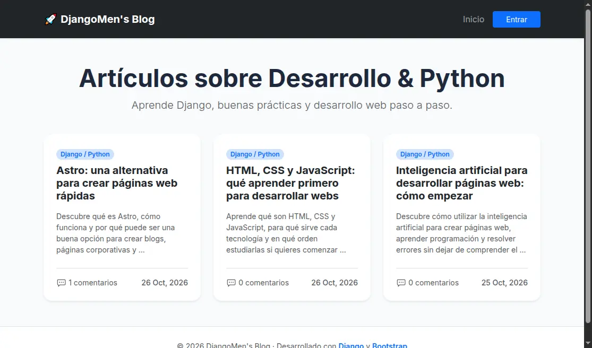
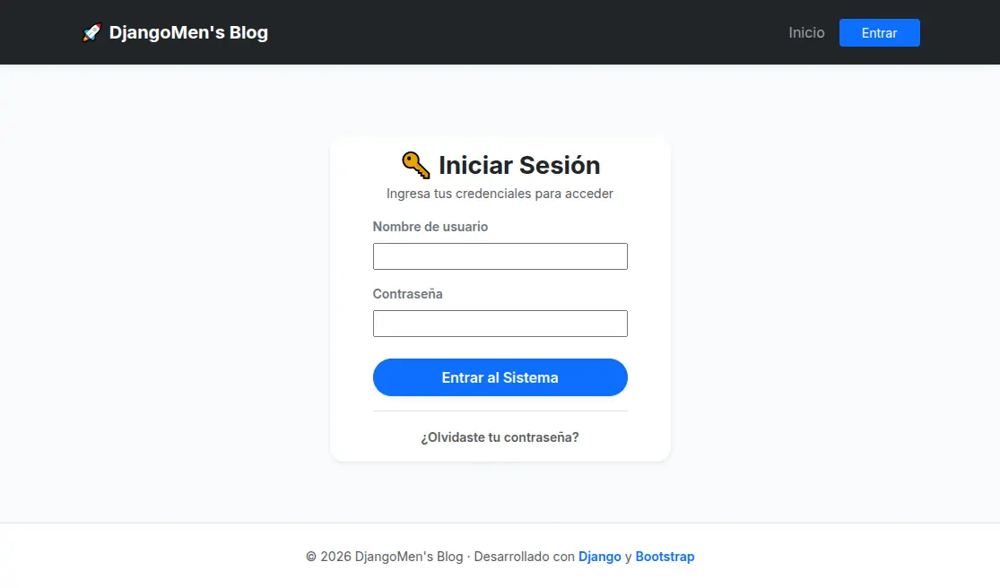
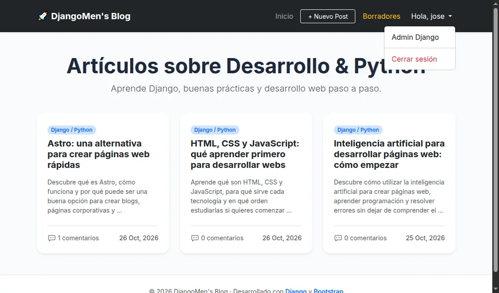
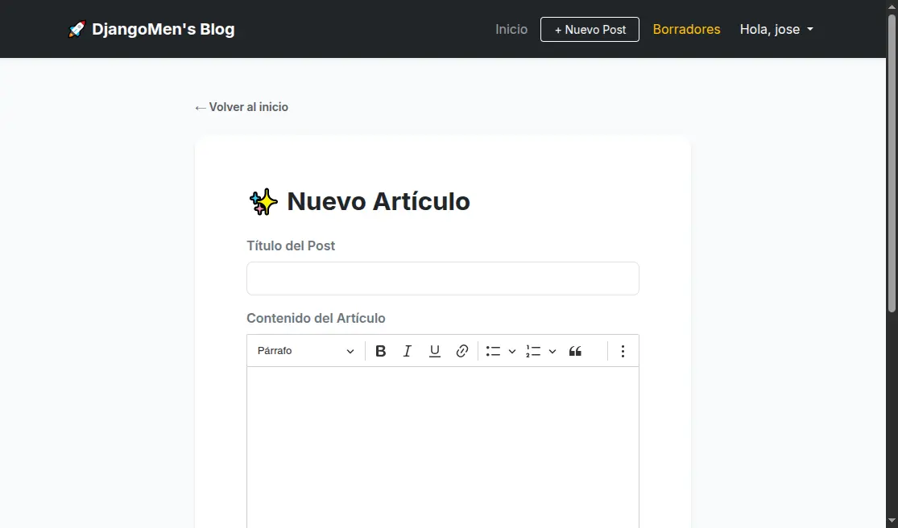
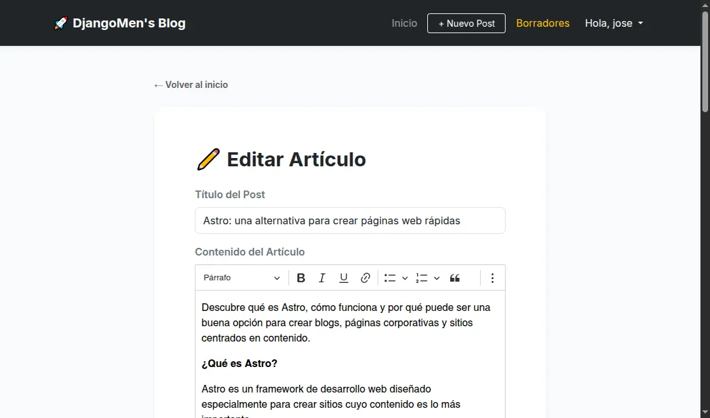

# djangomen

Example from the Django Girls tutorial.

**Live demo:** [https://djangomenblog.pythonanywhere.com/](https://djangomenblog.pythonanywhere.com/)

## Production settings

Copy `.env.example` to `.env`, generate a new `DJANGO_SECRET_KEY`, and set the
production domain in `DJANGO_ALLOWED_HOSTS`. The settings module loads `.env`
automatically. Keep `.env` private; it is excluded from Git.

Generate a key in the project's virtual environment with:

```bash
python -c "from django.core.management.utils import get_random_secret_key; print(get_random_secret_key())"
```

Home page of the blog without logging in.



Login to manage the blog



Page with the blog administration menu.



Add new post.



Publish, edit, and delete a post.


